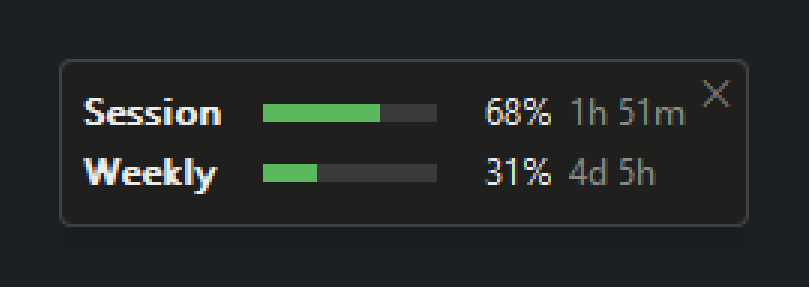

# Claude Usage Widget

A tiny always-on-top Windows widget that shows your Claude plan usage — the 5-hour
**session** limit and the **weekly** limit, each with time until reset — so you don't
have to keep typing `/usage` in Claude Code.



- Single portable `.exe` (~1.5 MB). No installer, no admin rights, no runtime to install.
- Uses ~3–5 MB of memory while running. Quitting releases everything.
- Refreshes every 60 s by default (30 s / 60 s / 2 min / 5 min).
- Adjustable opacity (100 / 85 / 70 / 50 %).
- Sign in with any method claude.ai offers.

> ## ⚠️ Unofficial — read before using
>
> This is **not** an Anthropic product. There is no official API for plan usage, so the
> widget reads the same internal endpoint that claude.ai's own **Settings → Usage** page
> uses, with your own claude.ai web session.
>
> - It may **stop working at any time** if Anthropic changes that endpoint.
> - Anthropic's consumer terms restrict accessing the service "through automated or
>   non-human means". A read-only check of your own usage once a minute is low-impact,
>   but it is arguably in that grey area. **Use it at your own risk**; in principle your
>   account could be warned or suspended.
> - The widget never uses Claude Code's credentials, never bypasses bot protection, and
>   identifies itself honestly (`User-Agent: ClaudeUsageWidget/<version>`).

## Download and run

1. Download `ClaudeUsageWidget.exe` from the Releases page (or build it, below).
2. Put it anywhere (Desktop, a tools folder…) and double-click it.
3. **Windows SmartScreen** may say "Windows protected your PC" because the exe isn't
   code-signed. Click **More info → Run anyway**.
4. A **Sign in to Claude** window opens on first run. Sign in as you normally do.
   When it's done the window closes by itself and the widget shows your numbers.

The widget needs the Microsoft Edge **WebView2 Runtime** for the sign-in window. It ships
with Windows 11 and current Windows 10; if it's missing, the widget tells you where to get it.

### Signing in

| Method | Status |
|---|---|
| Google | Tested. Google opens in its own small pop-up; sign in there. |
| Email code | Should work (standard claude.ai page); not yet tested. |
| Apple, company SSO | Untested. |

If Google refuses to sign in inside the window, choose **Continue with email** and use
your Google address instead.

## Using it

- **Drag** it anywhere; it remembers where you left it.
- **Right-click** for the menu: Refresh now · Refresh every ▸ · Opacity ▸ ·
  Organization ▸ (only if you belong to more than one) · Sign out · Quit.
- **✕** quits.
- Bars turn amber at 75 % and red at 90 %.
- If the network drops, the last numbers stay visible, dimmed, with "Offline — retrying".
- Only one copy runs at a time; launching it again does nothing.

## Where it keeps things

| What | Where |
|---|---|
| Settings (opacity, interval, position, organization) | `%APPDATA%\ClaudeUsageWidget\settings.json` |
| Your claude.ai session, encrypted with Windows DPAPI (only your Windows account can read it) | `%APPDATA%\ClaudeUsageWidget\session.bin` |
| Temporary sign-in browser profile (deleted after sign-in) | `%LOCALAPPDATA%\ClaudeUsageWidget\WebView2` |

To remove everything: quit the widget, delete the exe, and delete the two
`ClaudeUsageWidget` folders above. **Sign out** in the menu deletes the widget's saved
session; it doesn't sign you out of claude.ai in your browser or elsewhere.

## Build from source

Requires Windows 10/11 x64, [Rust](https://rustup.rs) (stable, MSVC toolchain) and the
Visual Studio Build Tools (C++ workload).

```powershell
cargo test
cargo build --release
# -> target\release\ClaudeUsageWidget.exe
```

Debug builds accept `--demo` to show fake data without signing in:
`cargo run -- --demo`.

`scripts\leakcheck.ps1 -Minutes 180` samples the running widget's memory, handle and GDI
counts once a minute to check for leaks.

## License

MIT
